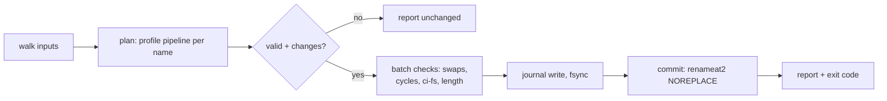

# detox (rewrite) — functional specification

Status: draft v0.2.5 · 2026-11-09
v0.2.5 delta: cross-platform build prep. `.cargo/config.toml` no longer forces a default musl target (broke native macOS/Windows builds); `crt-static` pinned per musl target. New: `file_identity()` (unix dev/ino, Windows volume-serial+file-index via GetFileInformationByHandle), macOS `renamex_np(RENAME_EXCL)` atomic no-replace, Windows `FILE_FLAG_OPEN_REPARSE_POINT` on overwrite opens, `dist/build.sh`, release CI matrix (draft). All targets compile-checked (`cargo check --all-targets`) for: x86_64/aarch64 musl, x86_64/aarch64 apple-darwin, x86_64-pc-windows-msvc. No behavior change.
v0.2.4 delta: binary renamed `detox-rs` (user ruling); env prefix `DETOX_RS_*`; journal dir `detox-rs/journal`. Behavior unchanged.
v0.2.2 delta: SAN stage corrected — golden vectors (§9 rows 1, 19) require *removal* of decoration punctuation `()[]{},;!$&`, not replacement with `_`; dots-family special case deleted (all-dots names reduce to `_` via standard pipeline, preserving INV-1). §3.1/§3.3/§5.5/§9 updated, no other behavior change.
v0.2.3 delta: reserved-name escape runs after LEN (catches truncation-created stems). Documented INV-1 exception: under caps where stem+1 > cap, the escape is cut to fit and a second application may shorten the name once more (`_CO → CO`); converges after at most two runs.
Sources (inspiration only, **not** behavioral reference): [dharple/detox](https://github.com/dharple/detox) v3.0.1 (paused 2025-08-10), [inflex/ripMIME](https://github.com/inflex/ripmime) 1.4.1.0. Known upstream defects we design against are indexed in §13. ripMIME in particular double-encodes UTF-8 attachment filenames — its decoder is a cautionary input to this spec, not a foundation.

## 1. Purpose and principles

Successor to `detox` (filename remediation) informed by the filename-handling failures of `ripMIME`. One sanitization core, two entry points: rename files already on disk, and (phase 2) extract attachments from MIME with clean names at birth. Upstream tools are inspiration; this spec is thought-through from first principles and every normative claim is testable (§11).

Non-negotiable principles, in priority order:

1. **Never lose data** — no overwrites, renames are journaled and undoable.
2. **Never escape the target directory** — a filename is a basename, always.
3. **Idempotent** — `detox(detox(x)) == detox(x)`.
4. **Just works** — zero config, zero install: copy the binary, run it. Encoding expertise is never required of the user.
5. **Portable by default** — names survive Linux ↔ macOS ↔ Windows interop and the common filesystems (§3.2), at the cost of nothing a 21st-century user needs.
6. **Scriptable** — machine-readable output, documented exit codes, dry-run is first-class.
7. **Copyable distribution** — the release artifact is a single static binary (§3.4). If `scp` or `docker cp` can move it, it runs.

## 2. What we take from upstream

| Upstream capability | Disposition |
|---|---|
| detox `safe`, `wipeup`, `max_length`, `lower`, `iso8859_1`/`cp1252`, `utf_8` (control chars), `uncgi` filters | Replaced by pipeline stages (§3.1); parity expressible via sequences |
| detox named sequences, `default`, `DETOX_RS_SEQUENCE`, `-n -r -s -f -L -v`, `--special`, `inline-detox` | Kept, modernized (§4); `-L` = `detox seq list` |
| detox `.tbl` translation tables + builtins | Kept as embedded TOML data (§6) |
| detox never-overwrite caveat, dotfile skipping, post-order dir renames, NUL → `_hidden_null_` | Invariants (§5, §10) |
| ripMIME basename extraction, quote trim, traversal defense | Stage DEC/SAN, done correctly (§3.1) |
| ripMIME RFC 2231 `?` heuristic | **Rejected** — it detects encoded names then never decodes them; we decode exactly once (§8, MIME-1) |
| ripMIME `--unique-names` prefix/postfix/infix | §5.8 |
| ripMIME decoders (QP/base64/uuencode/TNEF/OLE/MHT/mbox), `--recursion-max`, nameless-part handling, hardlink multi-name | `extract` phase 2 (§8) |
| ripMIME `--paranoid` 7-bit mangling | Rejected — lossy char→`_` mashing; replaced by the `ascii` profile with real transliteration |
| ripMIME NUL→space binary corruption (its own TODO), 1024-byte stack buffer | Rejected by design (safe language, byte-exact default) |

## 3. Architecture

Two-phase operation — **plan**, then **commit**. The entire rename set is computed and cross-checked before anything touches disk.



The pipeline operates on a `NameContext` = `{ name, parent_dir, filesystem_facts, run_config }`. `filesystem_facts` is probed per directory (§3.2): `NAME_MAX`, case-sensitivity, and never guessed from OS.

### 3.1 Pipeline stages (each independently togglable per sequence)

1. **NRM** — decode input to Unicode (Linux filenames may be arbitrary bytes: invalid UTF-8 → U+FFFD, never crash, always reported); NFC-normalize (fixes macOS NFD twins).
2. **DEC** — semantic decoders: `uncgi`; RFC 2047 encoded-words; RFC 2231 `filename*=` + continuations; surrounding-quote trim. Exactly one decode pass — see MIME-1.
3. **CHR** — source-charset decode (Latin-1, CP-1252, …) to UTF-8 when declared or forced.
4. **TRL** — transliteration to ASCII (NFKD → drop combining marks; locale digraphs `de`: ä→ae; compatibility map fi→fi, ①→1; unmappable → fallback `_`).
5. **CAS** — Unicode case folding (`lower`/`upper`; detox's `lower` is ASCII-only — defect COL-2).
6. **SAN** — safe-charset replacement + reserved-name policy (§3.3): whitespace/control and other disallowed chars → `_`; decoration punctuation `()[]{},;!$&` removed; NUL → `_hidden_null_` (v0.2.2).
7. **CLN** — collapse runs of `_`/`-` (dash precedence, detox semantics); strip leading `# _ -`; `remove_trailing` strips trailing `. _ -` (default on).
8. **LEN** — byte-length cap, fs-aware, extension-preserving, suffix headroom (§5.7).
9. **UNQ** — collision resolution (§5.8).

### 3.2 Filesystem capability model

Probed, not assumed. `NAME_MAX` via `pathconf`; case-sensitivity via temp-file probe (fs-type tables are unreliable — SMB exports and loop images vary); reserved-name policy is profile-driven, not fs-driven (a Linux ext4 dir may still be synced to NTFS).

| Filesystem | Component limit | Case | Notes |
|---|---|---|---|
| ext4, xfs, btrfs, zfs, tmpfs | 255 bytes | sensitive | reference behavior |
| APFS / HFS+ | 255 UTF-8 bytes | **insensitive** (HFS+ folds; APFS setting-dependent — probe) | NFD legacy: NFC output (NRM) keeps bytes stable |
| NTFS | 255 UTF-16 units | insensitive, fold-preserving | reserved names, trailing `.`/space illegal, `:` = ADS trigger, `MAX_PATH` 260 total |
| exFAT | 255 UTF-16 units | insensitive | same reserved/trailing rules as NTFS |
| FAT32 (LFN) | 255 UTF-16 units | insensitive | same; astral-plane chars cost 2 units |
| NFS / 9p / virtiofs / SMB export | inherited from server | server-defined | never trust client-side type — always probe |

Implications: `clean` caps at 255 **bytes** UTF-8 (safe for every column above for BMP text); `portable` caps at 255 **ASCII** bytes (strict subset of all UTF-16 limits, immune to astral-unit arithmetic); a full-path advisory (fires when the active profile is `portable` or `ascii`) warns when `dirname + name` would exceed 240 chars (`MAX_PATH` interop; a renamer cannot fix ancestors — warn, don't mangle).

### 3.3 Profiles

A profile = a named, versioned bundle of stage settings. Three built-ins; users may define more in config.

| | `clean` (**default**) | `portable` | `ascii` |
|---|---|---|---|
| Goal | 21st-century middleground: shell-safe, cross-platform-legal, keeps human text | Lowest common denominator for FAT32/exFAT/NTFS/MAX_PATH interop | Lossy legacy escape hatch (old detox `utf_8` sequences, ancient tooling) |
| Output charset | `\p{L}\p{M}\p{N}` + `. _ -` | ASCII letters/digits + `. _ -` | ASCII letters/digits + `. _ -` |
| Spaces/control | → `_` | → `_` | → `_` |
| Decoration punct `()[]{},;!$&` | removed | removed | removed (TRL output) |
| Other disallowed chars | → `_` | → `_` | → `_` via TRL first |
| Case | preserved | preserved | `--case` user's choice |
| Unicode kept | yes (NFC) | no (TRL) | no (TRL) |
| Windows reserved names (`CON PRN AUX NUL COM1–9 LPT1–9`, any case) | not escaped (opt-in: `portable`, or sequence opt `escape_reserved = true`) | escaped | escaped |
| Trailing `.`/space | stripped (CLN default) | stripped | stripped |
| Leading `-` | stripped | stripped | stripped |
| Component cap | 255 bytes, extension preserved | 255 bytes | 255 bytes |
| Full-path cap | advisory 240 | advisory 240 | advisory 240 |

Rationale for `clean`'s charset: with reserved-name escaping opted in (or on `portable`/`ascii`), everything it emits is legal on every filesystem in §3.2; it is safe in POSIX shells unquoted, URL-safe without encoding, and preserves the information users actually care about (words, in their language). What it sacrifices (`!$&`, emoji, commas) buys scriptability — the tool's raison d'être. All decisions above are overridable per sequence.

### 3.4 Distribution model

- Release artifact: **one statically linked binary per target** (`x86_64/aarch64-unknown-linux-musl`, macOS universal2, Windows MSVC, static FreeBSD where toolchain permits). musl static → runs in `scratch`/`alpine` containers, rescue shells, embedded targets; no libc, no installer, no man pages required.
- Build: `dist/build.sh [target …]` (v0.2.5) — per-target `cargo build --release --target <triple>`; the workspace no longer forces a default target (that broke native macOS/Windows builds). `crt-static` is pinned per musl target in `.cargo/config.toml`. aarch64 musl requires `aarch64-linux-musl-gcc` on PATH (the script fails fast naming it); every musl artifact is asserted static before packaging.
- All translation tables, sequences, and config **embedded in the binary**; `--init` optionally writes the default TOML config to stdout or `$XDG_CONFIG_HOME/detox/config.toml`.
- Acceptance test (§11): golden vectors run inside a `FROM scratch` container containing only the copied binary — must pass 100%.

## 4. CLI

```
detox-rs [check] [OPTIONS] PATH...           plan + report; changes nothing (DEFAULT)
detox-rs run PATH...  ≡  detox-rs --apply ...   apply renames
detox-rs undo [--last|--run ID]              restore names from journal
detox-rs seq list [-v]                       list sequences (= old detox-rs -L -v)
detox-rs extract [OPTIONS] -i MAILPACK -d DIR   MIME extraction, phase 2 (§8)
```

Bare `detox-rs PATH` never touches disk (user ruling 2026-11-09: safety over detox muscle memory; muscle memory is served by `--apply` and the `run` alias). `--apply` is the only way to execute a plan.

| Flag | Behavior |
|---|---|
| `--apply` | execute the plan; the only way anything is renamed |
| `-n, --dry-run` | plan only — this is the default; flag kept for explicitness and detox muscle memory |
| `-r, --recursive` | descend directories; `--max-depth N` cap (default 64 — untrusted trees need a ceiling) |
| `--hidden skip\|include\|only` | dotfile policy; default `skip` (detox parity) but the report counts and lists them — detox hid this (UX-2) |
| `--profile clean\|portable\|ascii` | profile override (§3.3); config sequences refine, not replace, profiles |
| `-s, --sequence NAME` | named sequence (env `DETOX_RS_SEQUENCE` still honored) |
| `-f, --config FILE` | config file; skips discovery |
| `--include GLOB` / `--exclude GLOB` | pattern filters (upstream had only exact-name ignores) |
| `--ci auto\|on\|off` | case-insensitivity handling; default `auto` = probe (§3.2) |
| `--special` | operate on sockets/FIFOs/devices; default skip + report count |
| `--follow-symlinks` | off by default; symlinked dirs never descended |
| `--case lower\|upper\|preserve` | CAS override |
| `--max-length N` | LEN override (0/absent = fs limit) |
| `--ascii` | shorthand for `--profile ascii` |
| `-0, --null` | NUL-delimited I/O for `xargs -0` interop |
| `--format human\|json` | `json` = NDJSON `{action, old, new, reason, stage}` per line (UX-4) |
| `--strings` | inline-detox replacement: map stdin names to stdout; nothing touched on disk |
| `-v, --verbose`, `-q, --quiet`, `-h`, `-V` | parity |

Exit codes (detox's are undocumented — UX-5): `0` nothing to do or all applied cleanly · `1` applied with warnings (uniquified, policy-`skip` skips, advisories) · `2` one or more failures (permission, journal write, undo conflict, or any collision under `--on-collision error`) · `3` usage/config error.

## 5. Hard requirements

### 5.1 Plan-before-commit (PLN)
Full old→new map computed and cross-checked before the first rename: intra-batch swaps and cycles (committed via temp names), duplicate targets, ci-fs fold collisions, post-rename length violations. A failing plan aborts before any change unless `--best-effort`.

### 5.2 Atomicity and no-clobber (INV-2)
`renameat2(RENAME_NOREPLACE)` on Linux; elsewhere `lstat` + `rename(2)` with the residual race accepted and journaled. Renames never span filesystems: old and new share a parent directory, so `rename(2)` semantics apply and file data is never copied (EXDEV is architecturally unreachable). Existing/appearing targets trigger UNQ policy — never an overwrite. `extract --overwrite` arms only when passed twice (ripMIME parity, deliberate footgun preserved and documented).

### 5.3 Journal and undo (UND)
Every committed run appends to `$XDG_STATE_HOME/detox/journal/<ts>.jsonl` (or `$HOME/.local/state`, or a user-set `DETOX_RS_JOURNAL_DIR` — state dir discovery is itself specified because root-owned trees are a real case: `sudo` runs must journal somewhere writable, so `--journal-dir` also exists). Entry: run id, cwd, `{old, new, dev, inode}` per rename, fsync'd before the first rename of the batch. `detox-rs undo --last` reverts in reverse order; refuses when a restore target is occupied by a *different* file (dev+inode check). Retention 30 days, configurable. detox has none of this (UX-1). Journal write or fsync failure aborts the run **before any rename** (exit 2, zero changes). Crash/interrupt mid-apply leaves the journal as the source of truth; `undo` tolerates partial application — an entry whose `new` path is missing or whose dev+inode mismatch the journal is skipped with a warning (exit 1), and undo never guesses. **Failure taxonomy**: a run that fails before committing any rename (journal write failure, first-rename error, e.g. read-only directory) leaves no journal and zero changes; a run that fails after ≥1 rename keeps its journal marked `partial: true`, exit 2, and `undo --last` still reverts the committed entries. **Undo against a since-deleted parent directory**: skip-with-warning, exit 1 — undo never recreates directories.

### 5.4 Case-insensitive filesystems (COL)
On ci filesystems (probed, §3.2): case-only renames (`Foo→foo`) commit via temp name; distinct inputs folding equal (`A.txt`, `a.txt`) are collisions → UNQ. Fold comparison uses full Unicode simple folding, per-FS flavor differences absorbed by the UNQ fallback (a name that collides on HFS+ but not NTFS still gets uniquified — harmless, deterministic).

### 5.5 Name safety (SAN, INV-3)
Outputs match `[^\0/]+`; never `.` or `..`; never begin with `-`; no trailing space or period; Windows reserved names escaped per profile; UTF-8-encoded NUL → `_hidden_null_` (detox CHANGELOG 2.0.0b1 — kept deliberately visible); profile charset enforced (§3.3). A name consisting solely of dots reduces to `_` through the standard pipeline (CLN trailing-dot strip → emptiness guard) — deliberately no special case, so `...` and `____` converge to the same INV-1 fixed point. **Emptiness guard**: any stage producing an empty string collapses it to `_`; empty output is unreachable (covers e.g. `---` → strip leading dashes → `_`).

### 5.6 Batch integrity (INV-4)
Old→new mapping injective within a run unless UNQ distinguishes results. Verified in PLN.

### 5.7 Length (LEN)
Cap = min(config `max_length`, probed `NAME_MAX`, profile cap), counted in bytes of the output encoding (`clean`: UTF-8; `portable`/`ascii`: ASCII). Truncate on character boundary, preserve final extension (incl. two-extension files, per detox 2.0 fix), reserve ≤16 bytes for the UNQ suffix so a uniquified name cannot itself exceed the cap.

### 5.8 Collision resolution (UNQ)
`--on-collision uniquify|skip|error`; default `uniquify`. Deterministic counter, `infix` before extension by default (`report_1.pdf`); styles `prefix|infix|postfix` (ripMIME parity). Input ordering by `(path, inode)` makes counter assignment stable across reruns.

### 5.9 Walk semantics (WALK)
Directories renamed post-order (children first — detox does this right; specified so it survives refactors). Dotfiles per `--hidden`. Special files skipped unless `--special`. Mount boundaries never crossed unless `--xdev`. Hardlinks: all names of one inode enumerated; `--dedupe-hardlinks` (opt-in) collapses duplicate content to one name + link, reported (generalizes ripMIME's multi-filename hardlinks).

## 6. Configuration

TOML, discovered in order: `--config` → `./.detox.toml` (walk root only, opt-in `--local-config`) → `$XDG_CONFIG_HOME/detox/config.toml` → embedded defaults. The C-like yacc/lex detoxrc is retired.

```toml
default_profile = "clean"
default_sequence = "clean"          # sequence = profile + stage overrides

[sequences.ascii-lower]
profile = "ascii"
[sequences.ascii-lower.stage.cas]
case = "lower"

[stage.unq]
style = "infix"
on_collision = "uniquify"
```

Sequences are data, not code; unknown stage = exit 3. `DETOX_RS_SEQUENCE` still selects the default. Translation tables: user tables as TOML at `$XDG_DATA_HOME/detox/tables/<name>.toml` (or config `tables_dir`) — codepoint→string + `default` fallback + per-locale overrides; builtins `safe`, `unicode`, `cp1252`, `latin1` embedded; legacy `unidecode.tbl` importable for detox 1.x/2.x emulation.

## 7. Transliteration (TRL)

Per codepoint: (1) exact table hit; (2) NFKD decomposition, drop combining marks (é→e; ß→ss via table); (3) locale digraph table (`de`: ä→ae, ö→oe, ü→ue, ß→ss); (4) compatibility map (fi→fi, ①→1, fullwidth→ASCII); (5) fallback `_`. Every change attributed to a stage in `--format json` output (`reason` field).

## 8. `extract` — MIME attachment extraction (phase 2)

Same binary, same name pipeline, same journal. Nothing ships until phase 1 conformance is green (§11).

- **EXT-1 Input**: `-i FILE|-`, `-d DIR` (must exist; every emitted path provably under DIR), `--mailbox`, `--formdata` NUL-preserving mode.
- **EXT-2 Decoders**: base64, quoted-printable, uuencode, TNEF/winmail.dat, OLE/CFB, MHT, embedded-message recursion; `--recursion-max N` default 20 (ripMIME's DoS guard, kept); per-decoder kill switches (`--no-tnef` …).
- **EXT-3 Filename resolution** — the point of the exercise: source precedence per RFC 6266 §4.3: `filename*=` / `filename*0*=` continuations first, then `filename=`, then `Content-Type name=`; then RFC 2231 reassembly → RFC 2047 encoded-words → declared-charset decode to UTF-8 → §3.1 pipeline. **Single-decode invariant (MIME-1)**: after any decode step, if the string is valid UTF-8, no further percent/charset pass may fire. ripMIME's behavior — detect the `?`, give up, then double-encode what was already UTF-8 — is the canonical regression test (§9).
- **EXT-4 Uniqueness**: `--unique-names` default with `--unique-style prefix|postfix|infix`; `--overwrite` double-armed.
- **EXT-5 Nameless parts**: `-p PREFIX` (default `text`), `--name-by-type`, `--no-nameless`.
- **EXT-6 Multiple filename params** on one part: hard link per additional name (default); `--no-multiple-filenames`.
- **EXT-7 Reporting**: `-e FILE` header dump; `--verbose-defects`; NDJSON per part `{file, content_type, size, source_part}`.
- **EXT-8 Byte-exact decoded content**; NUL handling opt-in (ripMIME inverts this and corrupts binaries — its own TODO admits it).

## 9. Golden test vectors

Table-driven; every vector asserted on ext4 (ci-sensitive), a probed-ci loop image, and in the §3.4 scratch container.

| Input | `clean` result | exercises |
|---|---|---|
| `My Report (final).docx` | `My_Report_final.docx` | SAN, CLN |
| `foo  bar__baz--qux.txt` | `foo_bar_baz-qux.txt` | CLN collapse + dash precedence |
| `résumé.pdf` (NFC) / `résumé.pdf` (NFD) | identical outputs, flagged ci-collision | NRM, COL |
| `Ä.TXT --case lower` | `ä.txt` | CAS full-Unicode (COL-2) |
| `日本語 レポート.txt` | `日本語_レポート.txt` | clean keeps Unicode |
| `file①.txt --profile ascii` | `file1.txt` | TRL compatibility |
| `=?UTF-8?B?w6ZmZmljZS5wZGY=?=` (`-s mime`) | `æffice.pdf`, one decode pass | DEC, MIME-1 |
| `filename*=UTF-8''%C3%A6ffice.pdf` (`-s mime`) | `æffice.pdf`, one decode pass | DEC-2231, MIME-1 |
| Already-UTF-8 name carrying literal `%C3%A6` (`-s mime`) | **not** re-decoded | MIME-1 negative |
| `report.pdf` ×2 in one mailpack | `report.pdf`, `report_1.pdf` | UNQ infix |
| `a↔b` swap in one batch | both renamed via temp names | PLN cycles |
| `CON.txt` | unchanged (`clean`); `_CON.txt` (`--profile portable`) | SAN reserved, opt-in |
| `.` / `..` / `...` | `_` in all cases (trailing-dot strip + guard, SPEC §5.5) | SAN/CLN edge |
| 300-byte UTF-8 name | truncated to cap−suffix, extension kept | LEN |
| Astral-heavy 255-unit exFAT name | `portable` profile → fits FAT limits | §3.2 |
| `text%20edit%2Bplus.txt -s uncgi` | `text_edit_plus.txt` | DEC uncgi |
| `a\0b.txt` (embedded NUL) | `a_hidden_null_b.txt` | SAN NUL marker |
| `--help.txt` | `help.txt` | SAN leading dash |
| `name, with (punct)!$&.txt` | `name_with_punct.txt` (removal set, no collapse needed) | profile charset |
| raw non-UTF-8 bytes `ff fe 61.txt` | `��a.txt` → `a.txt` (leading `_` stripped per CLN) | NRM repair |
| full path >240 chars target | advisory warning, name unchanged | §3.2 MAX_PATH |

## 10. Invariants

- **INV-1 Idempotency** — any profile applied twice converges; second run's plan is empty, exit 0.
- **INV-2** No overwrite of pre-existing or batch-created paths. Ever.
- **INV-3** Every emitted name is a safe basename under its target dir; `.`/`..` and leading `-` unreachable; profile charset enforced.
- **INV-4** Old→new mapping injective per run (modulo UNQ suffixes); verified in PLN.
- **INV-5** Any committed run is undoable until its journal entry is pruned.
- **INV-6** `--format json` output is valid NDJSON even under `-q`.
- **INV-7** All output names are valid UTF-8 (portable/ascii profiles: valid ASCII). Input may be arbitrary bytes; output never is.
- **INV-8** `portable`-profile names are provably legal on FAT32/exFAT/NTFS (255 ASCII bytes, reserved names escaped, no trailing/leading violations) — enforced by test, not hope.

## 11. Verification and conformance

"Much better tested" is a requirement, not a vibe (items 1–6 are addressable as §11.1–§11.6):

1. **Golden vectors** (§9) — must pass on ext4, tmpfs, a ci loop image (vfat or ntfs3g), and inside the §3.4 `FROM scratch` container. Host test/clippy gating runs on all three OSes via `.github/workflows/ci.yml`; the loop-image and scratch-container legs are release-gate jobs in `release.yml` (§3.4), added with the first tagged release — until then they run in the maintainer environment per TESTPLAN §1.
2. **Filesystem matrix** — mkfs.vfat/mkfs.exfat/ntfs3g loop images × all three profiles × the vectors; APFS/HFS+ behavior verified via fold-simulation tests where the real fs is unavailable (APFS ci-insensitivity is probed at runtime by the tool itself — §3.2).
3. **Property tests** — idempotency (INV-1), injectivity (INV-4), undo round-trip (`undo(run(x))` restores byte-exact names), no-clobber under concurrent renamer noise.
4. **Fuzz** — arbitrary-byte filenames (Linux permits anything but `/` and NUL); mutated/truncated UTF-8; RFC 2047/2231 header fuzz with double-encoding mutants (MIME-1 must never fire twice); deep paths; boundary lengths (254/255/256 bytes, astral-unit arithmetic on exFAT profile).
5. **Fallacy coverage** — every row in §13 maps to ≥1 automated test, named after the defect ID.
6. **Determinism** — same input tree (any traversal order) ⇒ identical plan, identical UNQ counters.

## 12. Non-goals

Content-aware renaming (hashes/EXIF), fixing contents or permissions, mail parsing beyond MIME/TNEF/OLE/MHT/uuencode, non-UTF-8 output names, Windows as a host OS (Windows-*legal names* only), filesystem repair, indexing.

## 13. Fallacy → fix index

| # | Upstream defect (evidence) | Fix | Verified by |
|---|---|---|---|
| COL-1 | No normalization; NFD/NFC twins distinct on disk | NRM (§3.1), COL (§5.4) | vector 3 |
| COL-2 | detox `lower` ASCII-only (detoxrc.5) | CAS full-Unicode fold (§3.1 stage 5) | vector 4 |
| COL-3 | ci-fs handled by ad-hoc 2008 patch (detox CHANGELOG 1.2.0) | probed, specified invariant (§3.2, §5.4) | matrix §11.2 |
| UNQ-1 | collision → skip + error (detox.1 CAVEATS) | UNQ uniquify default (§5.8) | vector 10 |
| LEN-1 | `max_length` config-fixed; no NAME_MAX awareness | §5.7 fs-probed byte cap | vectors 14–15 |
| TRL-1 | detox v3 dropped Unicode transliteration; static tables | NFKD engine + data tables (§7) | vector 6 |
| TRL-2 | invalid UTF-8 passed through | NRM repair, U+FFFD, reported; INV-7 | vector 20 |
| TRL-3 | non-UTF-8 input behavior undefined upstream | specified: repair, never crash | fuzz §11.4 |
| UX-1 | no undo | journal + `detox-rs undo` (§5.3) | §11.3 |
| UX-2 | dotfiles silently skipped in `-r` (2.0.0b1) | `--hidden` + report visibility | CLI §4 |
| UX-3 | yacc/lex config grammar; "weighty configuration" (maintainer) | TOML, sequences as data (§6) | config tests |
| UX-4 | no machine-readable output | NDJSON (§4) | INV-6 |
| UX-5 | exit codes undocumented | §4 | CLI tests |
| RAC-1 | check-then-rename TOCTOU | `renameat2(RENAME_NOREPLACE)` (§5.2) | §11.3 |
| DIS-1 | detox needs installed tables/config under `/usr/share`; ripMIME builds from 2009-era C tree | single static binary, embedded defaults, scratch-container acceptance (§3.4) | §11.1 |
| MIME-1 | ripMIME detects RFC 2231 `?` but never decodes; **double-encodes already-UTF-8 names** (filename-filters.c) | single-decode invariant (§8 EXT-3) | vectors 7–9 |
| MIME-2 | ripMIME `--paranoid` mangles non-7-bit to `_` | `ascii` profile with real transliteration | §3.3 |
| MIME-3 | ripMIME `tmp[1024]` stack buffer, no length propagation | safe language, no fixed buffers, §5.7 | fuzz §11.4 |
| MIME-4 | ripMIME default NUL→space corrupts binaries (own TODO) | EXT-8 byte-exact default | extract tests |

## 14. Implementation notes (non-binding)

Recommended: **Rust**, precisely because §3.4 and §11 are the hard parts — musl-static single binary, `renameat2` via `rustix`, `unicode-normalization`, `deunicode`-class TRL fallback, `encoding_rs` for CHR/EXT-3, `walkdir`+`rayon`. Library-first: CLI is a thin wrapper so `extract` shares the pipeline. Alternates acceptable only if every §9 vector and §10 invariant passes unmodified on the §11.1 matrix.
